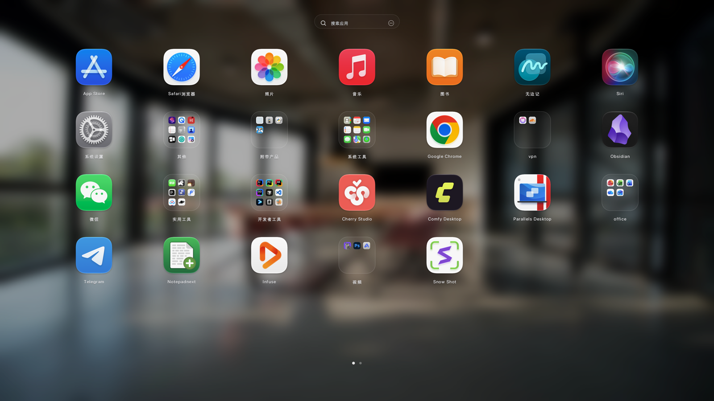
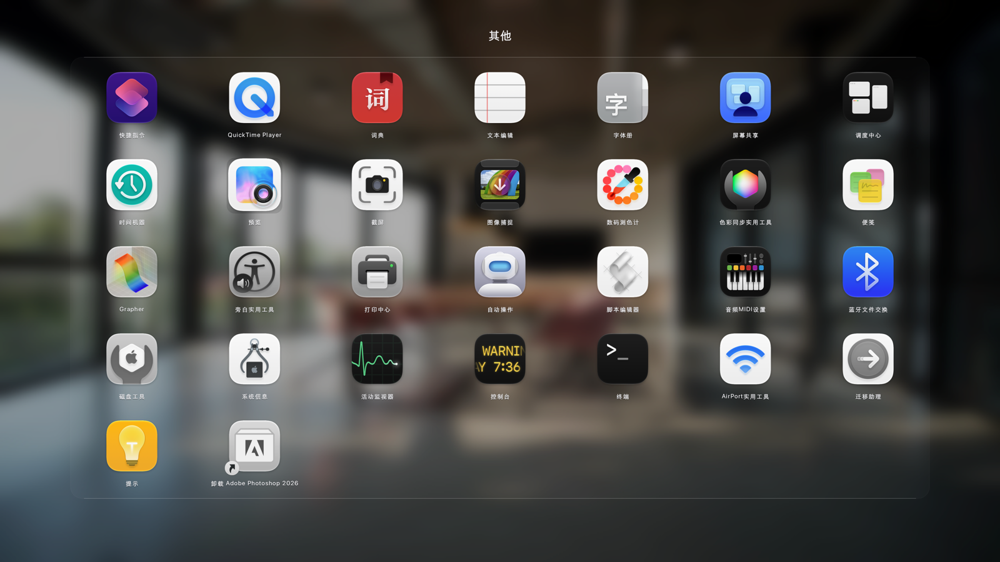
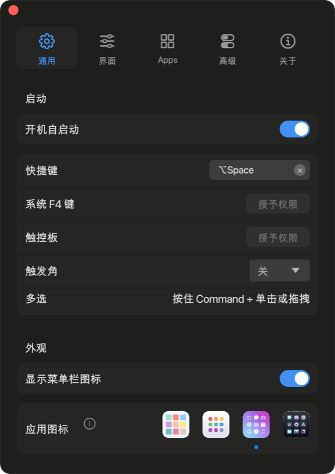

# LaunchDeck（Rust 复刻版）

用 Rust 从零实现的 macOS 启动台（Launchpad）替代品：分页网格、文件夹、搜索、拖拽整理、多选、卸载页、全局快捷键、菜单栏常驻，界面尺寸与交互按原版 LaunchOS 2.4.0 逐像素量取后对齐。

> 本仓库不包含、也不依赖原版二进制；布局数据可以从原版留下的 `LaunchOS.sqlite` 一次性导入，之后完全由本项目维护。



| 文件夹 | 设置 |
| --- | --- |
|  |  |

---

## 目录

- [特性](#特性)
- [系统要求](#系统要求)
- [安装](#安装)
- [构建与运行](#构建与运行)
- [使用](#使用)
- [设置项说明](#设置项说明)
- [数据与缓存](#数据与缓存)
- [项目结构](#项目结构)
- [1:1 复刻是怎么做的](#11-复刻是怎么做的)
- [开发与调试](#开发与调试)
- [已知限制](#已知限制)
- [声明](#声明)

---

## 特性

### 启动台

- **应用网格**：自动扫描 `/Applications`、`/System/Applications`、`~/Applications` 等目录，解析 Info.plist（含二进制 plist），按 bundle id 去重；设置里可添加/删除自定义扫描目录。
- **真实图标**：通过随包的 `icongen`（NSWorkspace）批量导出，支持 `Assets.car` 里 sips 读不到的图标；Retina 下按 2× 渲染。
- **分页**：方向键 ←/→、触控板横扫、点击页点翻页；翻页是 0.24s 缓出滑动，新旧两页同时位移。
- **滚动浏览**：浏览样式选「滚动」时所有应用排成一张长网格连续滚动（滚轮或拖动滚动条）。
- **文件夹**：拖一个应用压到另一个应用上即合并；面板内 3×3 预览；打开后按行数自适应高度；双击标题就地重命名；拖出应用自动收起文件夹并把应用放到落点格。
- **拖拽整理**：拖动时图标跟随指针、原位空出、后续图标依次前移、目标格高亮；支持跨页、拖进文件夹、拖出文件夹。
- **整理**：整理空位（当前页/全部页）、整理布局（勾选若干页收拢）、按名称/添加日期/上次使用排序（可同时排序文件夹内应用、指定 Apple 应用排前/排后）。
- **搜索**：输入即搜，回车启动第一个结果，Esc 清空。
- **类型筛选**：主菜单（空白处右键或搜索栏「⋯」）→「类型」，按系统应用分类（游戏/效率/实用工具等 22 类）过滤网格。
- **右键菜单**：打开 / 在访达中显示 / 添加到程序坞 / 隐藏 / 显示简介 / 卸载（深度卸载，含残留清理）/ 重命名 / 取消分组 / 新建文件夹。
- **多选**：⌘+单击、⌘+拖拽框选、右键全选；可批量隐藏、移入废纸篓、用所选应用新建文件夹；选中后整体拖动。
- **隐藏应用**：右键隐藏，设置页可恢复；可选择是否在搜索结果中出现。
- **深度卸载**：卸载前检测应用是否正在运行（可退出/强制退出），扫描 11 类残留（应用文件、支持文件、容器、容器组、WebKit 数据、偏好设置、已保存状态、缓存、启动项、崩溃日志、其他），逐类勾选后统一移入废纸篓；缺「完全磁盘访问权限」时给出授权入口。替身应用只移除替身文件本身。
- **替身文件**：网格中可以放指向任意位置 .app 的替身/符号链接，启动与图标均解析到目标。

### 外观

- 按原版 2.4.0 的量取值实现（见 [1:1 复刻](#11-复刻是怎么做的)）：搜索胶囊 244×40、7 列网格列距 251.6、行距 180.4、图标可见 105、页点 y=1043.5。
- **毛玻璃背景**：读取当前桌面壁纸，模糊 + 提饱和 + 压暗；壁纸变化时自动重新生成。文件夹打开时用同一张图整幅覆盖，下层图标被完全盖住且不改变色调。
- **动画**：打开 0.36s 淡入（背景 1.04→1.0、网格 0.965→1.0 缩放），关闭 0.24s 淡出；文件夹 0.26s 缓出放大 / 0.18s 收起；图表悬停 1.035×。
- 深色主题、SF Pro 字体（自带字距补偿）、隐藏名称开关、网格行列自定义。

### 系统集成

- **全局快捷键**：Option+Space 与 F4（Carbon `RegisterEventHotKey`，不需要辅助功能权限）。
- **触控板横滑翻页**：CGEventTap 监听横向滚动（需要辅助功能权限）。
- **触控板捏合**：三指/四指/五指捏合打开、张开关闭（NSEvent 全局监听，设置里可选手指数）。
- **多屏**：「启动台显示在」可选主屏幕/鼠标所在屏幕/Dock 所在屏幕/当前激活屏幕，全屏与窗口模式都按目标屏幕定位。
- **回到主页面**：重新打开时可按时长（5s–5min）/始终回到第一页，否则延续上次浏览位置。
- **菜单栏常驻**：左键打开启动台，右键菜单（设置 / 全屏 / 窗口 / 刷新 / 退出）。
- **触发角**：四个角落任选。
- **真全屏**：无边框窗口铺满屏幕，窗口层级 25 覆盖菜单栏与 Dock；关闭后恢复。
- **窗口模式**：1200×800 无边框圆角窗口，按住空白处可拖动。
- **切换应用自动收起**：切到别的 App 时启动台自动隐藏；设置窗口保持打开。
- **Dock 图标**：点击 Dock 图标（reopen）也会打开启动台；可隐藏 Dock 图标改为纯菜单栏应用。
- **开机自启动**：写入 `~/Library/LaunchAgents/app.launchdeck.macos.plist`。

### 其他

- **卸载页**：按占用大小排序、批量勾选、确认后走深度卸载流程。全部功能免费，无会员/试用限制。
- **布局管理**：按名称 / 添加日期 / 上次使用排序；JSON 导入导出（系统文件对话框）；自动持久化，应用增删后自动合并。
- **应用重命名**：右键「重命名」可改网格里的显示名（不影响磁盘文件）。
- **更新检查**：通过 GitHub Releases API 检查新版本（可自动检查/自动打开下载页），悬停可看更新说明。

---

## 系统要求

- macOS 13 或更高（开发与测试环境 macOS 26 / Apple Silicon）
- 构建需要：Rust stable、Xcode Command Line Tools（`swiftc`）

## 安装

### 方式一：使用发布包

1. 从 GitHub Releases 下载 `LaunchDeck-<version>.zip` 并解压；
2. 把 `LaunchDeck.app` 拖进「应用程序」文件夹；
3. 首次打开右键 →「打开」。本地构建的包是 ad-hoc 签名、没有经过 Apple 公证，Gatekeeper 会提示“无法验证开发者”；在「系统设置 → 隐私与安全性」里点「仍要打开」即可。

也可以直接去掉隔离标记：

```bash
xattr -dr com.apple.quarantine /Applications/LaunchDeck.app
```

### 方式二：从源码安装

```bash
git clone <repo-url> LaunchDeck
cd LaunchDeck
./install.sh
```

`install.sh` 会先构建，退出正在运行的实例，然后把 `dist/LaunchDeck.app` 拷到 `/Applications/LaunchDeck.app` 并启动。只构建、不安装：

```bash
./install.sh --build-only
```

### 卸载

```bash
osascript -e 'tell application "LaunchDeck" to quit'
rm -rf /Applications/LaunchDeck.app
rm -rf ~/Library/Application\ Support/LaunchDeck
rm -rf ~/Library/Caches/LaunchDeck
rm -f ~/Library/LaunchAgents/app.launchdeck.macos.plist
```

> 从旧名字（LaunchOS 版本）升级时，`settings.json` 与 `layout.json` 会在首次启动时自动迁移到 `~/Library/Application Support/LaunchDeck/`，旧目录不会被删除。

### 打包发布与公证

`./package.sh` 生成 `dist/LaunchDeck-<version>.zip` 及 SHA-256，可直接上传 GitHub Releases。若希望用户双击即开（不出现 Gatekeeper 提示），需要 Apple Developer ID 证书签名并公证：

```bash
codesign --force --deep --options runtime --sign "Developer ID Application: ..." dist/LaunchDeck.app
ditto -c -k --keepParent dist/LaunchDeck.app dist/LaunchDeck-notarize.zip
xcrun notarytool submit dist/LaunchDeck-notarize.zip --keychain-profile <profile> --wait
xcrun stapler staple dist/LaunchDeck.app
```

## 构建与运行

```bash
git clone <repo-url> LaunchDeck
cd LaunchDeck
./build.sh
open dist/LaunchDeck.app
```

`build.sh` 依次完成：

1. `cargo build --release -p launchdeck-gui`
2. 编译 `tools/icongen.swift`（图标导出）与 `tools/symbolgen.swift`（SF Symbols 渲染）
3. 组装 `dist/LaunchDeck.app`：可执行文件、图标、`symbols/`、`iconstyles/`、`Info.plist`
4. `codesign --force --deep --sign -`（ad-hoc 签名）

默认只构建当前架构（arm64）。需要 x86_64 时：

```bash
rustup target add x86_64-apple-darwin
cargo build --release --target x86_64-apple-darwin -p launchdeck-gui
```

更多细节见 [docs/BUILDING.md](docs/BUILDING.md)。

---

## 使用

### 打开启动台

| 方式 | 说明 |
| --- | --- |
| 全局快捷键 | Option+Space 或 F4 |
| 菜单栏图标 | 左键点击 |
| 触发角 | 设置里开启后，鼠标移到对应角落 |
| Dock 图标 | 点击 Dock 上的 LaunchDeck |
| 鼠标 | 在启动台内点空白处收起 |

> F4 若在「系统设置 → 键盘 → 快捷键」里被分配给了系统启动台，需要先解绑，否则会被系统优先响应。

### 快捷键

| 操作 | 快捷键 |
| --- | --- |
| 显示 / 隐藏启动台 | Option + Space、F4（全局） |
| 翻页 | ← / →，或触控板横向滑动 |
| 搜索 | 直接输入；Esc 清空 |
| 打开第一个搜索结果 | Enter |
| 关闭弹窗 / 文件夹 / 搜索 / 全屏 | Esc |
| 多选图标 | Command + 单击 |
| 框选 | Command + 拖拽 |
| 打开设置 | 菜单栏图标右键 → 设置，或右键空白处 → 设置 |
| 菜单 | 右键 |

### 拖拽

- **排序**：拖动图标 → 原位空出、后续图标前移 → 松手落到指针所在格。
- **合并成文件夹**：拖到另一个应用上松手。
- **加入文件夹**：拖到文件夹图标上。
- **移出文件夹**：打开文件夹后把应用拖到面板外，文件夹自动收起，应用落在指针所在格。
- **文件夹只剩一个应用**时会自动解散。

### 菜单栏

- 左键：打开启动台
- 右键：设置 / 全屏模式 / 窗口模式 / 刷新应用 / 退出

---

## 设置项说明

设置窗口是 400px 宽的独立浮窗（各标签页高度随内容：566 / 630 / 482 / 630 / 644），左上红点悬停显示 ✕，点击或 Esc 关闭。

### 通用

| 项目 | 说明 |
| --- | --- |
| 开机自启动 | 写入 LaunchAgent，登录时自动运行 |
| 快捷键 | 当前全局快捷键（⌥Space） |
| 系统 F4 键 | 是否成功注册 F4；「授予权限」跳转系统设置的辅助功能面板 |
| 触控板 | 横滑翻页监听是否生效（同上跳转授权） |
| 触发角 | 关闭 / 左上 / 右上 / 左下 / 右下 |
| 多选 | 操作提示：按住 Command + 单击或拖拽 |
| 显示菜单栏图标 | 关闭后变为纯快捷键应用 |
| 应用图标 | 四种图标样式，切换会立即替换 App 自身图标（Dock 与菜单栏同步） |

### 界面

| 项目 | 说明 |
| --- | --- |
| 显示模式 | 全屏 / 窗口（1200×800 无边框圆角窗口） |
| 隐藏程序坞 | 隐藏本应用的 Dock 图标（变为菜单栏应用） |
| 排序方式 | 自定义 / 名称 / 添加日期 / 上次使用 |
| 浏览样式 | 分页 / 滚动 |
| 网格布局 | 列数 × 行数（自定义） |
| 整理空位 | 按当前行列把应用向前整理 |
| 隐藏名称 | 只显示图标不显示文字 |
| 背景类型 | 系统壁纸 / 毛玻璃 |

### Apps

| 项目 | 说明 |
| --- | --- |
| 应用来源 | 默认扫描路径列表 |
| 在搜索结果中隐藏应用 | 被隐藏的应用是否出现在搜索里 |
| 隐藏的应用 | 已隐藏应用列表，可恢复 |

### 高级

| 项目 | 说明 |
| --- | --- |
| 启动台显示在 | 主屏幕 / 鼠标所在屏幕 / 程序坞所在屏幕 / 当前活动屏幕 |
| 回到主页面 | 重新打开时返回首页的等待时间 |
| 按住 Option 进入卸载模式 | 拖动图标时是否进入卸载手势 |
| 系统 Launchpad 数据 | 从原版数据库恢复布局 |
| 布局数据备份 | 导入 / 导出 JSON |
| 整理布局 | 按所选规则重新排列 |
| 自动检查 / 下载更新 | 预留项 |


---

## 数据与缓存

| 内容 | 路径 |
| --- | --- |
| 布局 | `~/Library/Application Support/LaunchDeck/layout.json` |
| 设置 | `~/Library/Application Support/LaunchDeck/settings.json` |
| 图标缓存 | `~/Library/Caches/LaunchDeck/icons-v2/` |
| 图标导出清单 | `~/Library/Caches/LaunchDeck/icons-v2/manifest.json` |
| 开机自启动 | `~/Library/LaunchAgents/app.launchdeck.macos.plist` |

删除缓存目录即可强制重新导出图标。

---

## 项目结构

```
launchdeck-core/          核心库（无 UI 依赖，可被其他前端复用）
  src/scanner.rs        应用扫描、Info.plist 解析、去重、目录大小
  src/config.rs         settings.json 读写
  src/model.rs          数据模型（AppInfo / AppSettings / DisplayMode…）
  src/util.rs           通用工具
launchdeck-gui/           eframe + egui 界面
  src/main.rs           入口、字体注入、窗口初值
  src/app.rs            状态机、扫描线程、拖拽、文件夹、键盘、动画状态
  src/ui.rs             网格、搜索栏、页点、文件夹浮层、右键菜单
  src/ui_settings.rs    设置窗口（五个标签页）与卸载窗口
  src/layout.rs         分页 / 文件夹数据模型
  src/layout_store.rs   布局持久化、自动组建、排序、重排
  src/icons.rs          图标导出与纹理缓存、SF Symbols 资源
  src/native.rs         Carbon 热键、NSStatusItem、CGEventTap、NSWorkspace 等原生调用
  src/wallpaper.rs      壁纸模糊 / 圆角 / 重饱和
  src/orig_layout.rs    原版 LaunchOS.sqlite 导入
launchdeck-ffi/           C ABI（liblaunchdeck_ffi.a / .dylib）
tools/icongen.swift     图标导出辅助程序（NSWorkspace）
tools/symbolgen.swift   SF Symbols → PNG（构建时渲染）
assets/iconstyles/      四种应用图标样式（含编译进二进制的 256px 兜底版本）
assets/ui/logo.png      关于页 logo
docs/                  截图与文档
build.sh                一键构建 .app
install.sh              构建并安装到 /Applications
package.sh              生成可发布的 zip（含 SHA-256）
LICENSE                 MIT
```

架构与原生集成细节见 [docs/ARCHITECTURE.md](docs/ARCHITECTURE.md)。

---

## 1:1 复刻是怎么做的

尺寸不是"看着差不多"，而是对着原版逐项量出来的：

1. **辅助功能树（AX）**：原版设置窗口是 SwiftUI，AX 树里能拿到每个控件的精确 frame、角色和文案。用它确定了窗口 400px 宽、五个 74×50 标签按钮（起点 x=19、步距 72）、360px 宽的分组卡片、13/11px 字号、36×16 开关等。
2. **像素量取**：启动台的网格、搜索胶囊、页点、文件夹面板无法从 AX 拿到，改用截图做投影分析——按列/行统计彩色像素或边缘，得到图标可见尺寸 105、列距 251.6、行距 180.4、页点中心 y=1043.5 等。
3. **能量对比**：背景模糊不是凭感觉调的。取原版与我们各自截图的同一区域，计算梯度能量（细节量）与平均亮度，把参数调到与原版一致（σ、压暗值、饱和度）。
4. **动画量取**：文件夹面板的缩放起点（0.86）、搜索胶囊的尺寸、页点的间距等，都是对截图量出来的。

量取时有个坑：原版有入场动画，唤出后立刻截图会量到动画中途的数值（列距 253.5 vs 稳定态 251.6），必须等 ≥1.5s 再截。

### 与原版的差异

- 原版的部分界面文案、图标属于其作者，本仓库只保留功能等价的实现；
- 应用图标样式来自用户提供的设计图，不包含原版资源；
- 原版不隐藏菜单栏/Dock，本实现做了更彻底的真全屏。

---

## 开发与调试

### 环境变量

| 变量 | 作用 |
| --- | --- |
| `LAUNCHDECK_TAB=settings` | 启动时直接进入设置页（调试布局用） |
| `LAUNCHDECK_NSDEBUG=1` | 输出原生调用日志（热键注册、展示选项、窗口层级等）到 stderr |

### 单独运行

```bash
cargo run -p launchdeck-gui --release
```

直接运行裸二进制时没有 `Contents/Resources`，应用图标会使用编译进程序的 256px 兜底版本，样式预览则退化为占位。

### 图标资源管线

| 资源 | 来源 | 构建时处理 |
| --- | --- | --- |
| 应用图标 | 系统 NSWorkspace | 运行时由 `icongen` 批量导出到缓存目录 |
| 设置标签图标 | SF Symbols | `symbolgen` 渲染为 2× PNG |
| 应用图标样式 | `assets/iconstyles/style0..3.png` | 复制到 bundle；256px 版本 `include_bytes!` 进二进制 |
| App 的 Bundle 图标 | `assets/iconstyles/style0.png` | `sips` + `iconutil` 生成 `Resources/AppIcon.icns` |
| 关于页 logo | `assets/ui/logo.png` | 复制到 bundle |

---

## 已知限制

- **手势**：横滑目前是横向滚动判定，不区分三指/四指；捏合手势依赖 NSEvent 全局监听，个别触控板事件组合可能漏报。
- **深度卸载**：残留扫描基于常见路径约定（bundle id / 应用名匹配），不能保证覆盖所有自定义安装位置；完全磁盘访问权限需手动授权。
- **更新**：通过 GitHub Releases 检查并打开下载页，暂无应用内下载安装。
- **语言**：界面目前只有简体中文（原版提供 21 种语言）。
- **单实例**：检测到已有实例会直接退出（两个实例会争抢同一个全局热键）。
- 菜单栏空间不足时图标可能被系统折叠。
- 需要辅助功能权限的两项（触控板、F4 授权入口）不会自动申请，需要手动在系统设置里授权。

## 声明

- 本项目是**从零实现的独立作品**，不包含原版 LaunchOS 的任何二进制、资源或私有代码。
- 界面尺寸与交互参考了对原版 2.4.0 的公开行为观察与量取，仅用于兼容性复刻与学习目的。
- 如果你需要使用原版功能，请购买原版授权。
